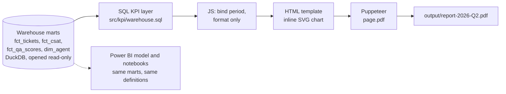
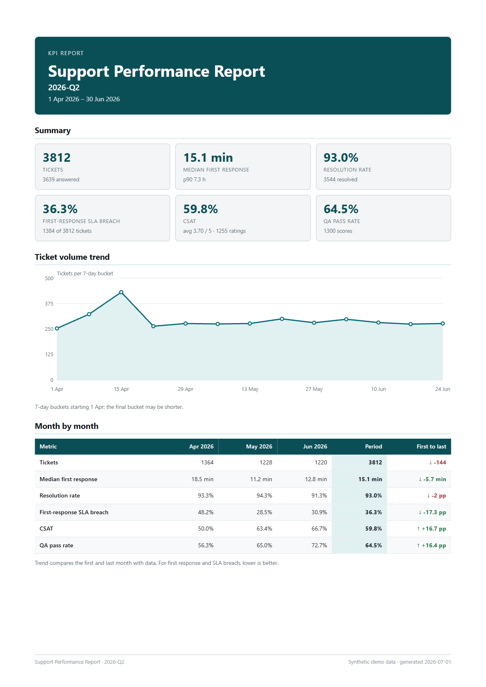
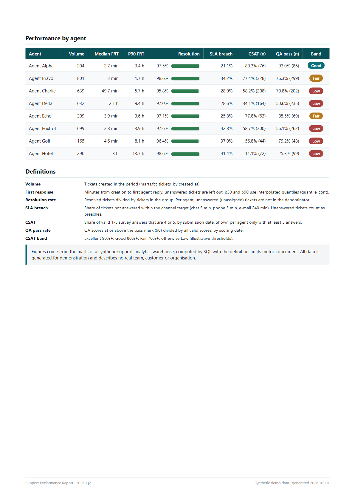
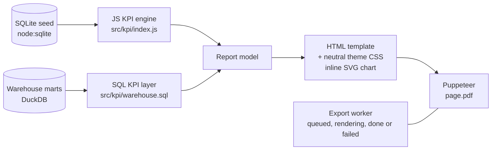

# automated-pdf-reporting

A KPI report that reads the same metrics layer as the dashboard. It takes the marts of the [support-analytics-warehouse](https://github.com/abdalrahmnamo-svg/support-analytics-warehouse) (DuckDB + dbt star schema), computes first-response time, resolution rate, SLA breach, CSAT, QA pass rate and volume in SQL, and prints a two-page PDF with Puppeteer, on demand or on a schedule. "One definition of each metric, used by the dashboard and the PDF."

> **All data is synthetic.** The warehouse is generated by a seeded script, and the standalone SQLite demo has 6 fictional agents. Nothing here describes a real team, customer or organisation.

## Where it fits



- **The SQL is the metrics layer.** Every KPI is one query in [`src/kpi/warehouse.sql`](src/kpi/warehouse.sql), per period, per agent and per month, written against the definitions in the warehouse's [`docs/metrics.md`](https://github.com/abdalrahmnamo-svg/support-analytics-warehouse/blob/main/docs/metrics.md). The JavaScript layer binds the period, converts types and formats; it computes no KPI.
- **Same numbers as the warehouse.** The report and any other consumer of the marts (the warehouse's SQL analyses, and the Power BI model and notebooks it builds on the same marts) quote the same figure for the same question, because they share one definition instead of each re-deriving it.
- **Standalone mode still works.** Without `--source warehouse` the report runs on a seeded SQLite demo database, so the repo can be cloned and run with no other project.

Sample (warehouse source, 2026-Q2, 3,812 synthetic tickets): [`docs/sample-report.pdf`](docs/sample-report.pdf)




## Metric definitions

The warehouse path follows the warehouse's definitions, cited from its [`docs/metrics.md`](https://github.com/abdalrahmnamo-svg/support-analytics-warehouse/blob/main/docs/metrics.md). Where the older SQLite demo computes a metric differently, the last column says how.

| KPI | Definition used with `--source warehouse` (SQL in `src/kpi/warehouse.sql`) | Standalone SQLite demo differs by |
| --- | --- | --- |
| Volume | Tickets created in the period (`fct_tickets.created_at`), including unassigned ones | Same, but counts "conversations" |
| First response time (FRT) p50 / p90 | `quantile_cont(first_response_minutes, 0.5 / 0.9)` over answered tickets, in minutes | p90 is nearest-rank (no interpolation) and the unit is seconds; median is the same statistic |
| Resolution rate | Resolved tickets / tickets in the group. Per agent, unanswered tickets are unassigned and therefore not in the denominator | Denominator is every conversation of the agent |
| First-response SLA breach | `not (answered and first_response_minutes <= target)`; targets chat 5 min, phone 3 min, e-mail 240 min; an unanswered ticket is a breach | Not available |
| CSAT | Share of valid answers (rating 1-5) that are 4 or 5, attributed to the day the answer was submitted (as `fct_agent_daily` does); invalid ratings 0 and 6 never reach the mart | Same 4-5 share, but attributed to the ticket's creation date |
| QA pass rate | QA scores with `is_passed` (pass mark 90) / all valid scores, attributed to the scoring date | Not available |

Display rules that are not part of a metric: a per-agent CSAT is shown only with at least 3 answers; a KPI with no underlying rows is `null` and prints as an em dash, never `0` or `NaN`; the CSAT band thresholds (90 / 80 / 70) are illustrative.

## Quick start

Standalone, no other project needed:

```bash
git clone https://github.com/abdalrahmnamo-svg/automated-pdf-reporting.git
cd automated-pdf-reporting
npm ci
npm run puppeteer:install       # only if Puppeteer did not download Chrome (or set PUPPETEER_EXECUTABLE_PATH)
npm run seed                    # creates data/support.db (deterministic)
npm run report -- --period 2026-Q1
# -> output/report-2026-Q1.pdf
npm test
```

From the warehouse (build it first with the [support-analytics-warehouse](https://github.com/abdalrahmnamo-svg/support-analytics-warehouse) quick start, which creates `warehouse/support.duckdb`):

```bash
npm run report -- --source warehouse --warehouse ../support-analytics-warehouse/warehouse/support.duckdb --period 2026-Q2
# -> output/report-2026-Q2.pdf
```

The file is opened read-only (`@duckdb/node-api`, pinned to the same DuckDB version as the warehouse), so a report never changes the warehouse.

Other commands:

| Command | What it does |
| --- | --- |
| `npm run report -- --from 2026-01-15 --to 2026-02-10` | Custom inclusive date range (UTC) |
| `npm run report -- --period 2026-02` | A single calendar month |
| `npm run report:html -- --period 2026-Q1` | Write `output/report-2026-Q1.html` only, for fast template iteration |
| `npm run report:schedule -- --every 60` | In-process `setInterval` scheduler; defaults to the quarter of the newest conversation, or pass `--period`/`--from`/`--to`. `--once` renders once and exits. With `--source warehouse` an explicit period is required |
| `node scripts/generate-docs.mjs --warehouse <support.duckdb>` | Regenerate `docs/sample-report.pdf` and the page screenshots from the warehouse (2026-Q2). `npm run docs:sample` does the same from the SQLite seed (2026-Q1) |

Set `REPORT_TITLE` (see `.env.example`) to change the report title; `REPORT_TIMEOUT_MS` changes the render timeout (default 60000); `WAREHOUSE_PATH` is the default for `--warehouse`.

## How it works



## Tech

Node 22.13+ (developed on 24), built-in `node:sqlite` for the standalone demo, `@duckdb/node-api` for the warehouse source, `puppeteer` (bundled Chrome), `node:test`. No Docker, no web server, no external CDN.

## Engineering notes

- **Worker status.** `ExportWorker` is an in-process queue (concurrency 1). A job moves `queued -> rendering -> done | failed`; the allowed transitions live in `src/worker/exportStatus.js` and illegal ones throw.
- **Timeouts and retry.** Each render attempt is raced against a timeout and gets an `AbortSignal`; the default renderer closes its browser on abort. A failed or timed-out attempt is retried once (`rendering -> queued -> rendering`) before the job is marked `failed` with the error message.
- **Why HTML to PDF.** The template is plain HTML/CSS with an inline SVG chart, so layout, tables, and print rules (`@page`, page breaks) come from the browser engine, and `npm run report:html` gives a fast preview loop. A PDF drawing library would mean hand-positioning every element.
- **SQL tested against hand-computed values.** `tests/warehouseKpi.test.js` builds a tiny DuckDB file in the mart shapes (a few tickets, CSAT answers and QA scores, plus rows just outside the period) and asserts the SQL returns the hand-computed FRT percentiles, rates, per-agent and per-month figures, and the exact period boundaries.
- **Deterministic seed.** `scripts/seed.mjs` uses a fixed-seed PRNG (mulberry32), so the same SQLite database is produced on every run. The sample PDF uses a fixed "generated" date for reproducibility.
- **Self-contained theme.** `src/report/performanceTheme.css` uses CSS variables, system fonts, and no external URLs. A test checks the document has no images, scripts, or remote references.
- **Chrome discovery.** `src/puppeteerLaunch.js` tries Puppeteer's bundled Chrome, then system Chrome/Edge/Chromium. Tests that need a browser skip themselves (with a reason) if none can be launched.

## Standalone SQLite KPI definitions

Used when `--source` is omitted (see the table above for how they differ from the warehouse):

| KPI | Definition |
| --- | --- |
| Volume | Conversations created in the period |
| First response time | Seconds from creation to first reply, answered conversations only. Reported as median and nearest-rank 90th percentile |
| Resolution rate | Resolved conversations / conversations created |
| CSAT | Ratings of 4 or 5 (scale 1-5) / all ratings. Per agent it is shown only with at least 3 ratings |

## Limitations

- Fixed layout for two A4 sheets; a table longer than a page flows onto extra pages but is not otherwise paginated or repeated beyond the browser defaults.
- The scheduler is a simple in-process timer, not a durable job system; if the process stops, nothing runs. The job queue and statuses are in memory.
- The warehouse source reads a DuckDB file; it does not run dbt and expects the marts schema (`marts.fct_tickets`, `fct_csat`, `fct_qa_scores`, `dim_agent`) to exist.
- UTC only; no timezone handling.
- English-only output. CSAT band thresholds are illustrative.
- `node:sqlite` is still flagged experimental in some Node versions and prints a warning.

## Background

Reworked from an internal reporting tool into a generic, synthetic-data demo; no real data, branding, or infrastructure is included.

## License

MIT
